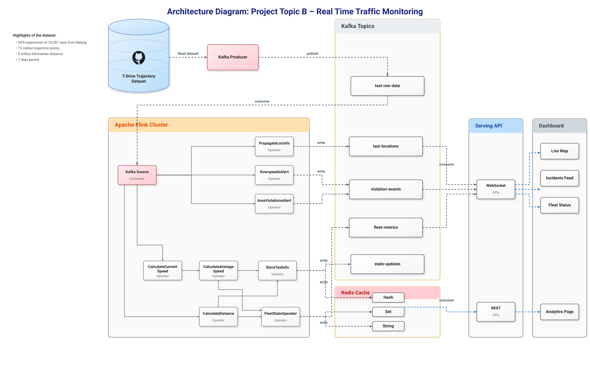

# 🚖 Real-Time Traffic Monitoring Topic B

[](https://flink.apache.org/)
[](https://kafka.apache.org/)
[](https://redis.io/)
[](https://www.python.org/)
[](https://www.docker.com/)

A real-time stream processing pipeline for monitoring Beijing taxi movement using the T-Drive Trajectory Dataset. The system ingests GPS events, calculates speed and distance, raises overspeed and geofence alerts, stores live taxi state, and feeds a live dashboard.

---

## 🏗️ Architecture

The pipeline uses Apache Kafka for ingestion, Apache Flink for stateful stream processing, Redis for fast state lookup, and FastAPI for REST and WebSocket delivery to the dashboard.



### Runtime Flow

```text
T-Drive dataset
   ↓
Dockerized Kafka producer
   ↓
Kafka topic: taxi-raw-data
   ↓
Apache Flink TrafficMonitoringJob
   ↓
Kafka output topics and Redis state store
   ↓
FastAPI REST/WebSocket backend
   ↓
Live dashboard at http://localhost:3000
```

---

## 📁 Project Structure

```text
bd26_project_w6_b/
├── data/                              # Local trajectory dataset, not committed
│   └── taxi_log_2008_by_id/           # GPS logs for each taxi, one file per taxi ID
├── docs/                              # Project documentation and diagrams
│   └── architecture.svg               # High-level architecture diagram
├── kafka/                             # Kafka infrastructure and ingestion
│   ├── producer/
│   │   ├── producer.py                # T-Drive replay producer
│   │   ├── requirements.txt           # Producer dependencies
│   │   └── Dockerfile                 # Dockerized producer
│   ├── topics/
│   │   └── setup_topics.py            # Kafka topic creation script
│   ├── benchmark/
│   │   └── measure_throughput.py      # Kafka throughput benchmark script
│   ├── connect/
│   │   └── redis-sink-connector.json  # Kafka Connect Redis configuration
│   └── README.md
├── flink_jobs/                        # Apache Flink stream processing jobs
│   ├── src/main/java/traffic/
│   │   ├── model/                     # Event models
│   │   ├── operators/                 # Cleaning, speed, alerts, metrics
│   │   ├── utils/                     # Haversine distance utility
│   │   └── TrafficMonitoringJob.java  # Main Flink topology
│   ├── src/test/java/traffic/         # Flink unit tests
│   ├── pom.xml                        # Maven configuration
│   └── README.md
├── api/                               # FastAPI backend
│   ├── main.py                        # FastAPI entry point
│   ├── config.py                      # API configuration
│   ├── rest.py                        # REST endpoints
│   ├── ws.py                          # WebSocket endpoints
│   ├── requirements.txt               # API dependencies
│   ├── Dockerfile                     # Dockerized API backend
│   ├── tests/
│   │   ├── conftest.py                # Test client and mocked Redis
│   │   └── test_rest_api.py           # FastAPI REST tests
│   └── README.md
├── dashboard/                         # Frontend visualization
│   ├── index.html                     # Live map and KPI dashboard
│   ├── Dockerfile                     # Nginx dashboard container
│   ├── nginx.conf                     # Nginx configuration
│   └── README.md
├── scripts/                           # Helper scripts
│   ├── submit_flink_job.ps1           # Build and submit Flink job
│   └── smoke_test.ps1                 # Service health check script
├── docker-compose.yml                 # Kafka, Redis, Flink, API, dashboard, producer
├── start.bat                          # Windows launcher
└── start.ps1                          # Plug-and-play PowerShell startup
```

---

## 📡 Kafka Topics

| Topic | Data Format | Description |
| :--- | :--- | :--- |
| `taxi-raw-data` | JSON | Raw telemetry from the producer |
| `taxi-locations` | JSON | Cleaned and throttled taxi positions for dashboard updates |
| `violation-events` | JSON | Speed and geofence alerts |
| `fleet-metrics` | JSON | Fleet-level metrics |
| `state-updates` | JSON | State transition events |

---

## 🔌 Docker Services

All services run inside the shared Docker network `taxi-network`.

| Service | Port | Description |
| :--- | :--- | :--- |
| Zookeeper | `2181` | Kafka coordination |
| Kafka | `9092` | Event broker |
| Kafka UI | `8080` | Kafka topic and message inspection |
| Redis | `6379` | Taxi and fleet state store |
| Flink JobManager | `8081` | Flink job coordination and UI |
| Flink TaskManager | Internal | Flink task execution |
| FastAPI Backend | `8000` | REST and WebSocket backend |
| Dashboard | `3000` | Live monitoring dashboard |
| Producer | Docker profile | Replays T-Drive files into Kafka |

Kafka listeners:

| Listener | Address | Used By |
| :--- | :--- | :--- |
| `EXTERNAL` | `localhost:9092` | Host tools and local scripts |
| `INTERNAL` | `kafka:29092` | Dockerized producer, API, Flink, Kafka UI |

---

## 🚀 Plug-and-Play Startup

### Prerequisites

| Requirement | Purpose |
| :--- | :--- |
| Docker Desktop | Runs the full local stack |
| PowerShell | Runs startup and validation scripts |
| T-Drive dataset | Local taxi GPS input files |

Place the dataset here:

```text
bd26_project_w6_b/data/taxi_log_2008_by_id/
```

The `data/` folder is local only and must not be committed to Git.

### Start the Project

Run from the project root:

```powershell
.\start.ps1
```

The startup script performs the full local run:

1. Checks Docker.
2. Starts Docker Compose services.
3. Waits for Kafka.
4. Creates required Kafka topics.
5. Builds and submits the Flink job using `scripts/submit_flink_job.ps1`.
6. Checks the Dockerized FastAPI backend.
7. Starts the Dockerized producer if the local dataset exists.
8. Prints service URLs.

Alternative Windows launcher:

```cmd
.\start.bat
```

---

## ✅ Smoke Test

After startup, run:

```powershell
.\scripts\smoke_test.ps1
```

The smoke test checks the required containers, service URLs, Kafka topics, Redis response, API health, and Flink job status.

---

## 📊 Service URLs

| Service | URL |
| :--- | :--- |
| Kafka UI | http://localhost:8080 |
| Flink UI | http://localhost:8081 |
| FastAPI Health | http://localhost:8000/health |
| FastAPI Docs | http://localhost:8000/docs |
| Live Dashboard | http://localhost:3000 |

---

## 📈 Benchmarking

The project includes a Kafka throughput benchmark script:

```text
kafka/benchmark/measure_throughput.py
```

The benchmark measures output topic throughput after the pipeline is running.

| Metric | Meaning |
| :--- | :--- |
| Total messages | Number of consumed messages |
| Average throughput | Average messages per second |
| Peak interval throughput | Highest short-interval message rate |
| Per-topic totals | Output message count by topic |

Benchmark results are used for project evaluation and presentation analysis.

---

## 🎥 Dashboard Visuals and Replay Speed

The producer replays historical GPS logs faster than real time. Flink calculates speed using the original timestamps from the dataset, not the wall-clock speed at which messages reach the dashboard.

Some taxis may look fast on the dashboard but remain green because the historical segment speed is still below the 50 km/h limit.

Violations:

| Violation | Behavior |
| :--- | :--- |
| Overspeeding | If speed is greater than 50 km/h, Flink emits an `OVERSPEED_50KMH` alert |
| 10 km warning zone | If a taxi crosses the 10 km radius around the Forbidden City, Flink emits a `WARNING_10KM` alert |
| 15 km discard zone | If a taxi leaves the 15 km radius, Flink emits a `DISCARD_15KM` alert and the dashboard stops drawing that taxi |

The dashboard receives location updates every 5 seconds per taxi to reduce browser and WebSocket load.

---

## 🗺️ Flink Topology

`TrafficMonitoringJob.java` follows this flow:

1. `taxi-raw-data` source reads raw GPS events from Kafka.
2. `DataCleaner` filters null values, invalid coordinates, and bad timestamps.
3. `ComputeSpeedAndDistance` calculates Haversine distance and speed between consecutive GPS points.
4. `StoreTaxiInfo` writes latest taxi state to Redis under `taxi:{taxiId}`.
5. `FleetStatsOperator` writes fleet metrics to Redis under `fleet:metrics`.
6. `PropagateLocationInfo` sends dashboard location updates every 5 seconds per taxi.
7. `OverSpeedAlert` emits alerts when speed is greater than 50 km/h.
8. `AreaViolationsAlert` checks 10 km and 15 km radii around the Forbidden City.
9. Kafka sinks publish `taxi-locations`, `violation-events`, and `fleet-metrics`.

---

## 🛑 Shutdown

Stop the pipeline:

```powershell
docker compose down
```

Clear Kafka data, Redis data, and Docker volumes:

```powershell
docker compose down -v
```

If the producer is running in a separate PowerShell window, close that window or press `Ctrl+C`.

---

## 🤖 AI Acknowledgment

This project was built with the assistance of AI. The AI was used to assist in:

- Prototyping the HTML, JavaScript, and CSS dashboard.
- Designing and troubleshooting the Apache Flink stream processing pipeline.
- Integrating WebSocket and Redis functionality.
- Authoring and maintaining project documentation.